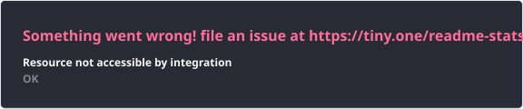

<h2 align="left">Hi 👋! My name is Tarun and I'm a Full-Stack Developer, from India.</h2>

###

  
  

###

  
  

###

###

<h3 align="left">🛠️ Tech Stack & Tools</h3>

  
  
  
  
  
  
  
  
  
  
  
  
  
  
  
  
  
  
  
  
  

###

<h3 align="left">📫 Connect with Me</h3>

  
  
  

###

 

<h3 align="center">⚡ GitHub Activity Snake</h3>

  

