<h2 align="left">Hi 👋! I'm Tarun Rawat, a BCA graduate and MERN Stack Developer from Uttarakhand, India. I love building web applications and exploring new technologies.</h2>

  
  

###

###

<h3 align="left">🛠️ Tech Stack & Tools</h3>

  
  
  
  
  
  
  
  
  
  
  
  
  
  
  
  
  
  
  
  
  

###

<h3 align="left">📫 Connect with Me</h3>

  
  
  

###

 

<h3 align="center">⚡ GitHub Activity Snake</h3>

  

